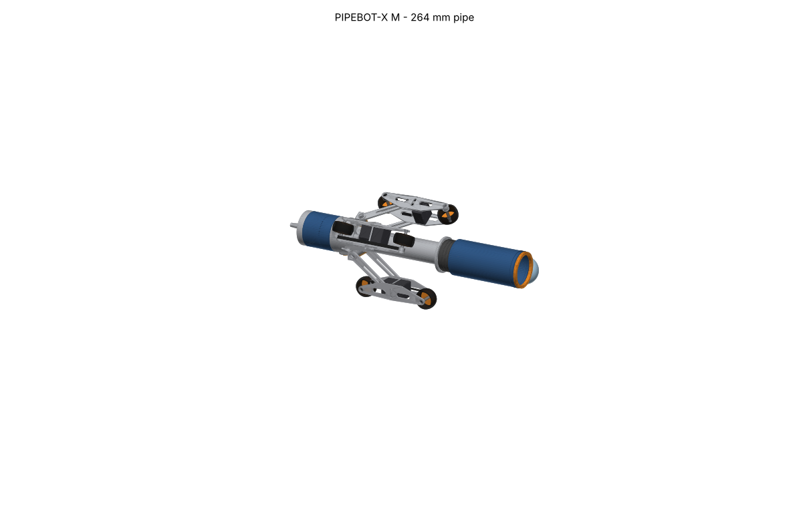

# PIPEBOT-X

Self-locking, diameter-adaptive, 3-arm / 6-wheel in-pipe inspection robot. It climbs
0-90 deg pipes, holds position with the power off, adapts to the pipe diameter, and streams
video and telemetry over a tether to a phone dashboard.

| Size | Pipe ID | Mass | Top speed | Power |
|---|---|---|---|---|
| S | 102-200 mm | 1.8 kg | 60 mm/s | tether |
| M | 152-320 mm | 4.2 kg | 95 mm/s | tether + 4S battery |
| L | 300-650 mm | 15.0 kg | 70 mm/s | tether + 6S2P battery |



**Single source of truth:** `params/bot_params.yaml`. Every calc, CAD dimension, firmware
constant, server limit and UI range is generated from it; its header lists every design
revision and why.

## Quick start

```bash
pip install -r requirements-dev.txt     # Python 3.11+, cmake, a C++17 compiler, Node 22
make params      # design calcs (fail on any violated requirement) + generated code
make cad         # STEP/STL/PNG, interference check, BOM, mass report, SolidWorks params
make fw          # firmware unit tests (native) + RP2040 builds for S/M/L
make sim         # software-in-the-loop simulator
make pi app      # Pi server tests, dashboard tests + build
make acceptance  # T1-T15 on the simulator -> docs/acceptance_report.md
```

Try the whole system on a laptop (simulated robot, real firmware, real server and dashboard):

```bash
make sim app
build/sil/pipebot_sil_M --scenario tests/acceptance/out/M/T7.json --tcp 7000 &
PIPEBOT_LINK=tcp://127.0.0.1:7000 PIPEBOT_CAMERA=synthetic uvicorn pi.app.main:app --port 8000
# open http://localhost:8000
```

(The scenario files appear after `make acceptance`; any JSON from
`docs/solidworks_and_simulation_guide.md` works.)

## Layout

| Path | Contents |
|---|---|
| `params/` | `bot_params.yaml` |
| `calc/` | `design_calcs.py` (all checks), `mechanism.py` (lever kinematics) |
| `cad/` | CadQuery modules A-E, assembly, interference check, exploded view, build; `exports/` |
| `protocol/` | wire protocol definition -> C++ / Python / TypeScript / JSON schema |
| `firmware/` | RP2040 firmware (control loops, state machine, safety), native tests, simulator (`sim_app/`) |
| `pi/` | FastAPI server: link, telemetry, commands with TTL, WebRTC/MJPEG video, recorder |
| `app/` | React PWA dashboard (Connect, Live, Run, Recordings, Settings) |
| `tests/` | unit tests, `acceptance/run_acceptance.py` (T1-T15) |
| `tools/` | generators, `plot_run.py`, `export_cad_params.py` |
| `docs/` | see below |

## Documents

- [Theory of operation](docs/theory_of_operation.md)
- [Real-world issues and FMEA](docs/real_world_issues.md): what was found and fixed, field risks
- [Recreate and simulate in SolidWorks and other tools](docs/solidworks_and_simulation_guide.md)
- [Acceptance report (simulated)](docs/acceptance_report.md) and [test plan (hardware)](docs/test_plan.md)
- [Operator manual](docs/operator_manual.md), [wiring diagram](docs/wiring_diagram.md), [pin map](docs/pinmap.md)
- [Assembly manual](docs/assembly_manual.md), [BOM](docs/bom.csv), [mass report](docs/mass_report.md), [fasteners](docs/fastener_table.md)

## Status

All design checks pass; CAD interference-free at 9 stroke positions for every size; firmware
builds warning-free for S/M/L; all unit test suites pass; simulated acceptance: every
test passes except **T5 horizontal centring** (documented deviation: ~6 mm gravity sag),
with **T10 video latency** and **T13 IP68** needing hardware. Friction values are estimates
until measured (see the test plan).
