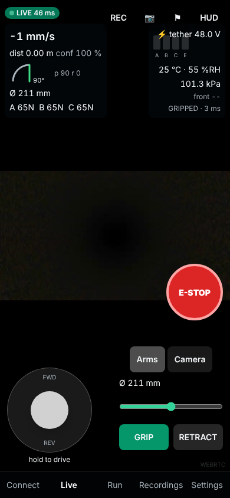

# Operator manual

## Before you go

- **Safety**: this robot is not certified for explosive atmospheres. Follow confined-space,
  gas-free and lock-out rules for the line. Never stand under a vertical pipe the robot is in.
- Clean or flush slimy drain lines first: wet biofilm cannot be climbed (see T6).
- Pick the size: S 102-200 mm, M 152-320 mm, L 300-650 mm pipe ID.
- Run the pre-job checks in `docs/test_plan.md`.

## Connect

1. Power the reel (48 V). Join the phone or tablet to the **PIPEBOT** Wi-Fi.
2. Open the dashboard address printed on the reel (it installs as an app; works offline).
3. **Connect** screen: robot size, firmware link, round-trip time. Enter your name. Run
   **Pre-flight**; every line must be green. **Run grip test** when the robot is in the pipe.

## Insert and grip

1. Retract the arms (Live > Arms > RETRACT) and slide the robot into the pipe mouth by hand.
2. Press **GRIP**. The arms close at the default force; the HUD shows force per arm
   (A/B/C). Wait for state **GRIPPED**. In a vertical pipe keep hold of the tether until then.

## Drive

- Hold the joystick: up = forward (toward the camera). Release = stop (the robot also stops
  by itself 0.3 s after the last command).
- Slow down (< 25 %) at joints, bends and anything the front range sensor reports.
- The **diameter** in the HUD is measured by the arms: use it to find deformation and
  sediment.
- Camera: Camera tab, pan (endless) and tilt (+/-90 deg). Lights: white and IR levels.

## Record

**REC** starts a run (video + telemetry + events). 📷 takes a snapshot with telemetry,
⚑ marks a defect at the current distance. Recordings: list, play, export CSV/MP4.

## When something goes wrong

| You see | Meaning | Do |
|---|---|---|
| Red **ROBOT LINK STALE** banner, controls greyed | No fresh telemetry for 0.5 s | Robot has stopped and is holding. Check the tether and Wi-Fi; it resumes when the link returns. |
| **GRIP_LOW** / **SLIP_WARNING** | Wall too slippery or pipe wider | Stop. Press GRIP. If it repeats, retreat. |
| **NO_CONTACT** | Pipe wider than the arms reach | Stop, reverse. |
| **EXPANSION_STALL** | Arms jammed | RETRACT a little, retry; inspect for debris. |
| **THERMAL_DERATE** | Motors hot, running at reduced current | Keep going slowly or pause. **OVERTEMP** stops motion. |
| **LOW_BATTERY** / LOW_POWER_SAFE | Battery (M/L) low | Return now. In LOW_POWER_SAFE the robot holds grip and waits for tether power. |
| Anything unexpected | | Long-press **E-STOP** (0.5 s). The robot stops and keeps its grip. Hold again to clear. |

## Retrieve

Drive back to the mouth, hold the tether, **RETRACT**, pull out by hand. If the robot is
stuck: retract, then reel in gently. The tether is the backup, rated 5x the robot weight.
