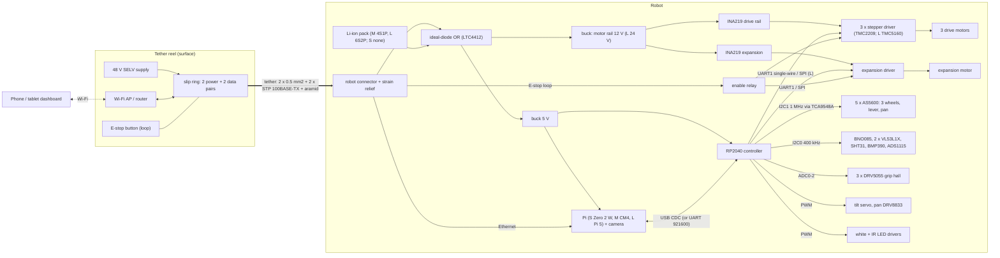

# Wiring diagram

Pin-level detail: `docs/pinmap.md` (generated from `firmware/include/pinmap.h`).

## Rules

- 48 V is SELV (< 60 V DC); still fuse it at the robot connector (size per `power.buck_*`).
- The E-stop is a **hardware loop** through the tether: open loop drops the driver enable
  relay, independent of software. The MCU only senses it (GP11).
- Keep the Ethernet pairs away from the motor wiring inside the hull; ground the tether
  shield at the reel only.
- Every through-hull cable passes a potted gland; see the seals list in
  `docs/assembly_manual.md`.
- Thermal: drivers and motors get thermal pads to the aluminium hull (T12 assumes it).
